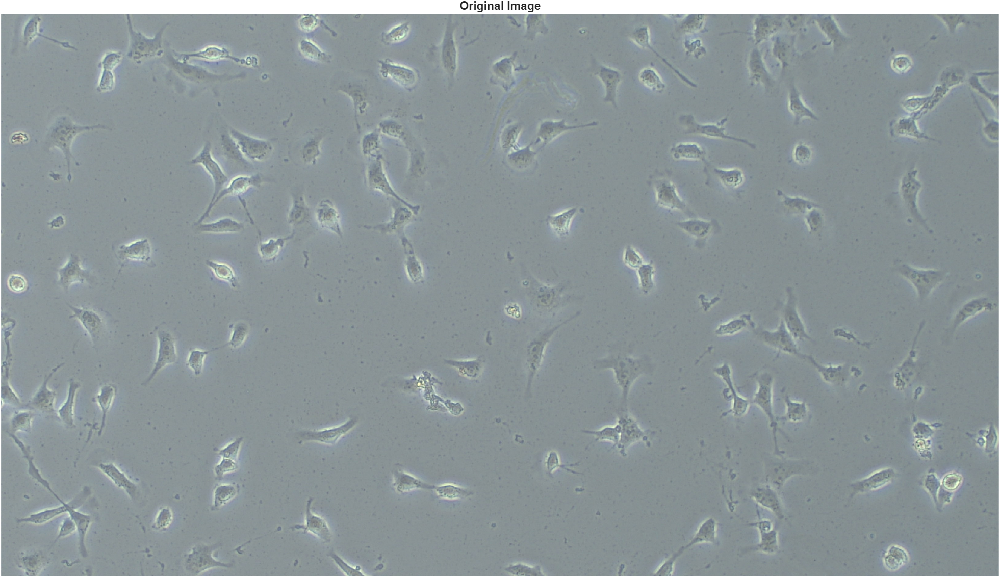
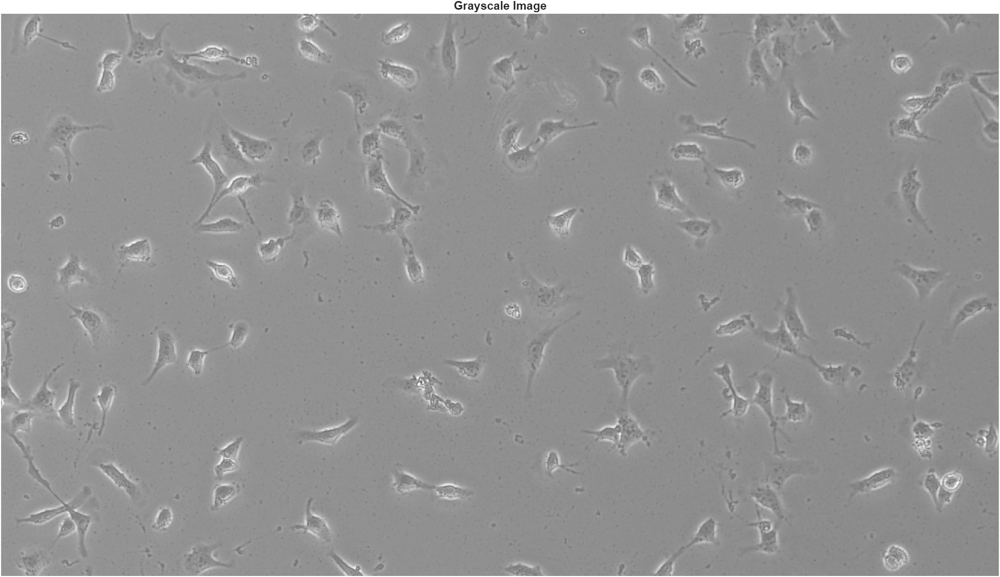
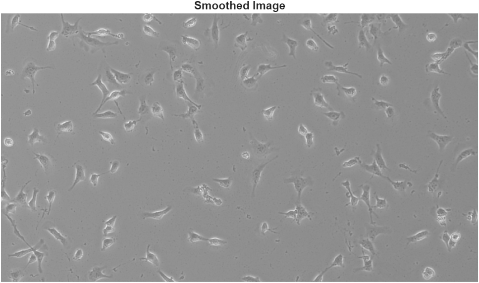
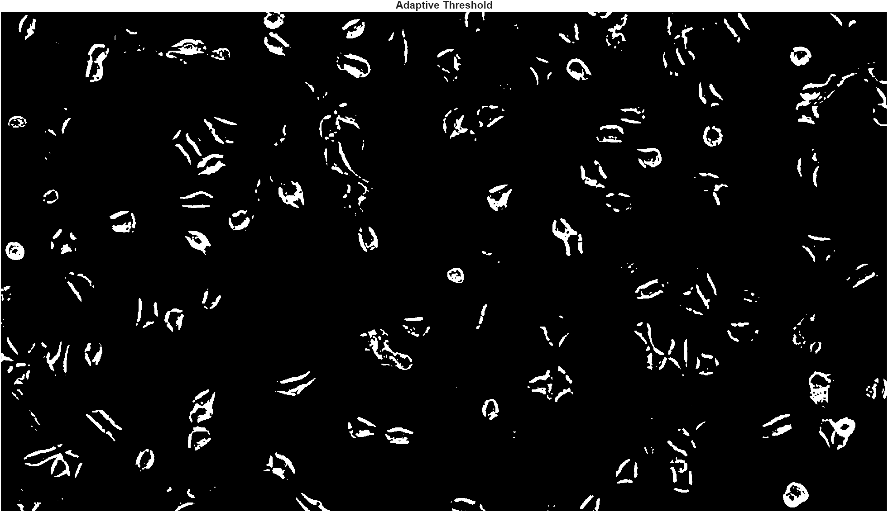
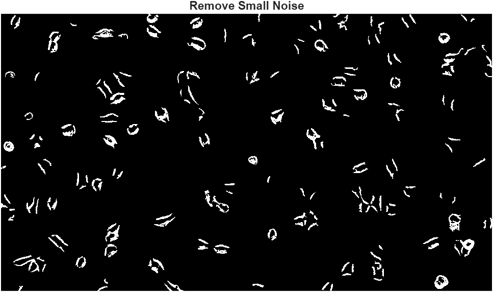
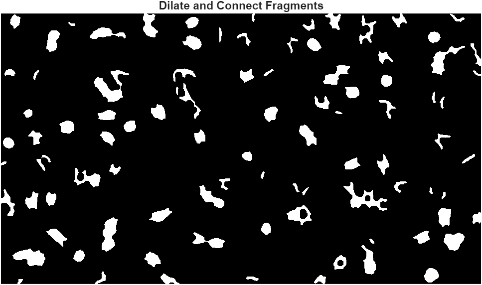
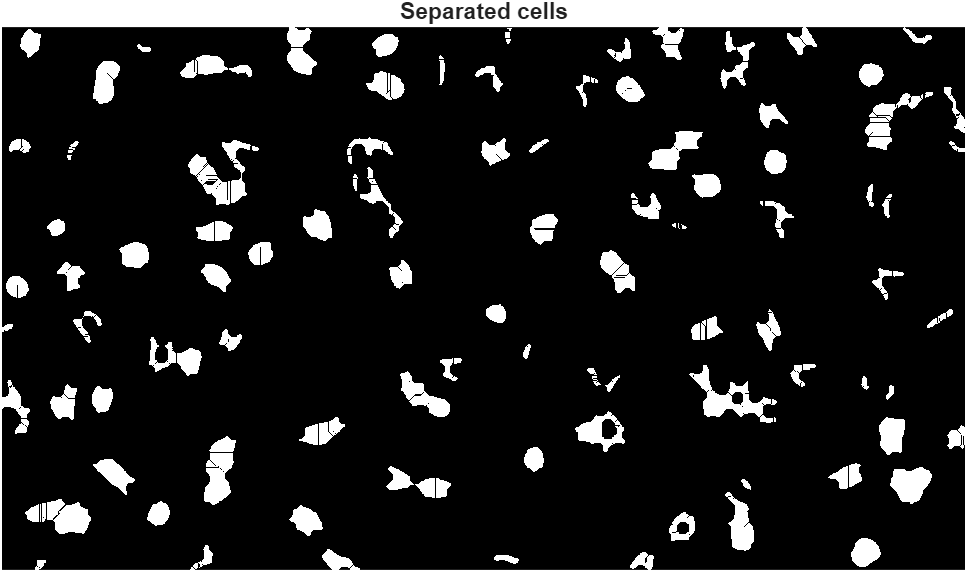
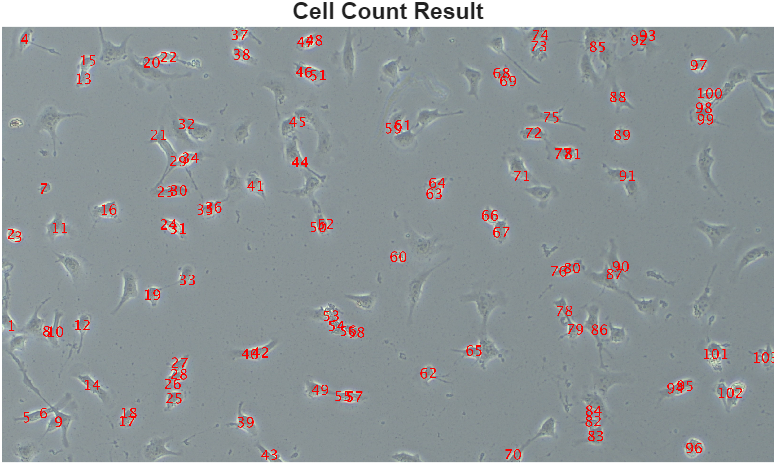

# Purpose
This repository documents a component of my final project for my Living Systems Analysis and Biostatisctics class, where I modified a class provided MATLAB script to count cell populations from microscope images of endothelial cell cultures.

# How to Use this Repository
## Requirements
This repository requires MATLAB.

## Setup
The main file of this repository is "count_cells.m". This file defines the MATLAB function that counts the cells within an image, taking an image as an input, and outputting the nubmer of cells in the image as well as a copy of the image with marked cell locations. The "example_funciton_call.m" file demonstrates an example of calling the funciton, using the "example_image.JPG" included in this repository. The final script in this repository is "analysis_visualization.m", which a version of "count_cells.m" that opens a figure for each operation performed on the image, allowing each step of the pipeline to be visualized. This script is especially useful for modifying parameter values of the operations in the analysis pipeline. Please find the image pipleine below in the "Example" section.

# Example
Here is an example of the purpose and function of each operation performed on an image in the "count_cells.m" pipeline, using "example_image.JPG":

# Limitations
This script is not a robust model for counting cells, and the parameters of "count_cells.m" have been finely tuned for endothelial cells with low confluency. This script will struggle to accurately count cultures with very high confluency, in particular.